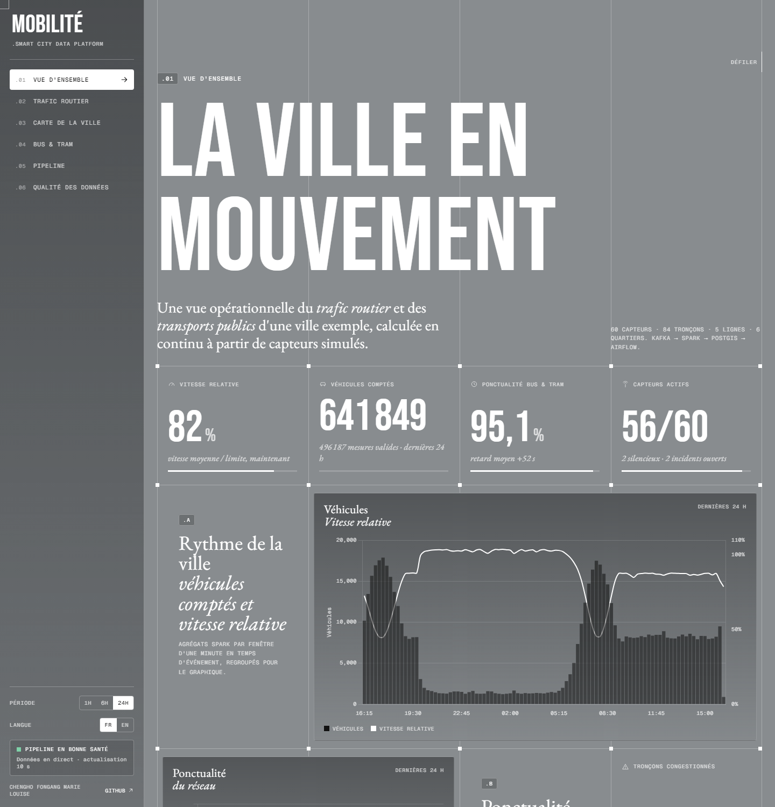
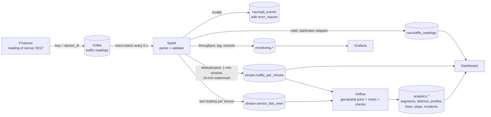
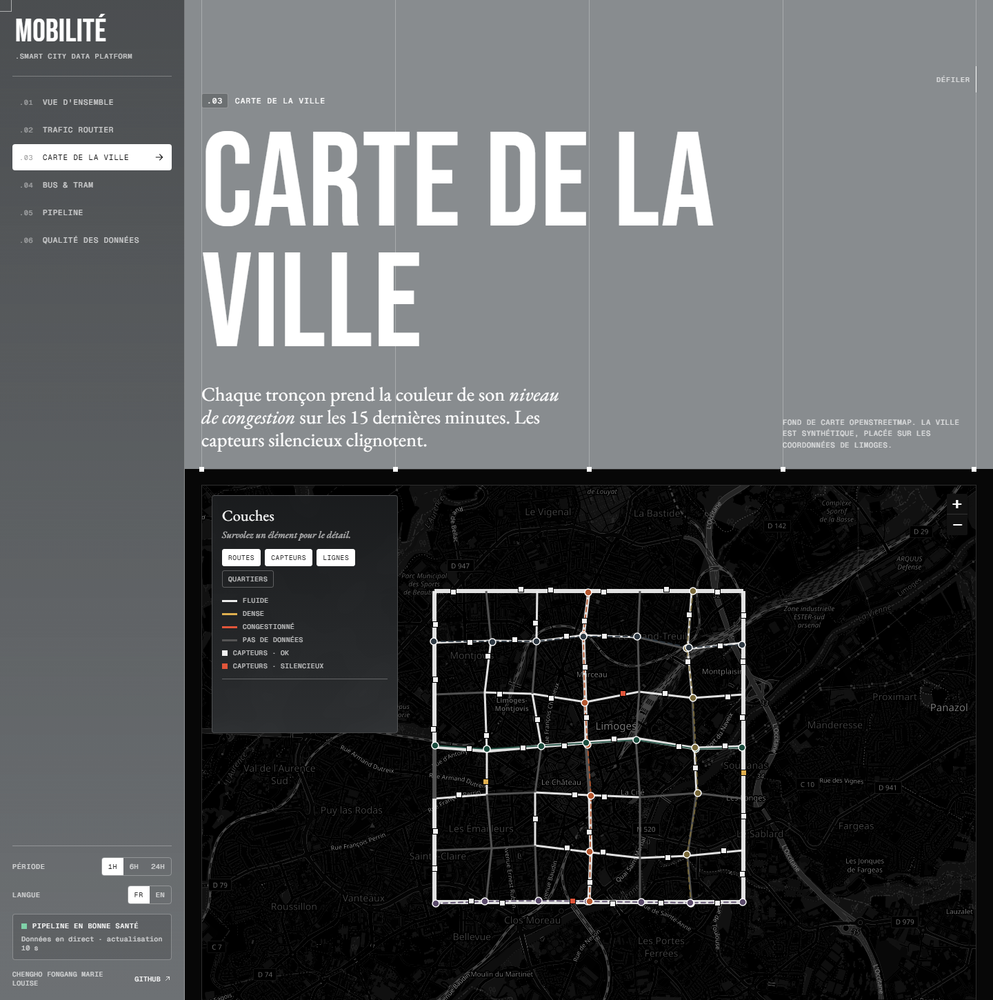
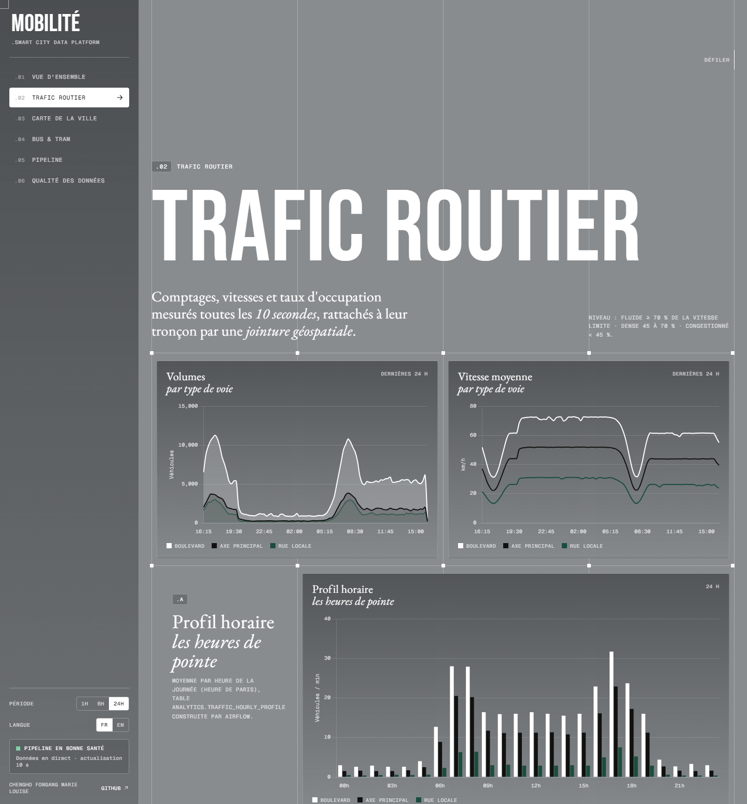
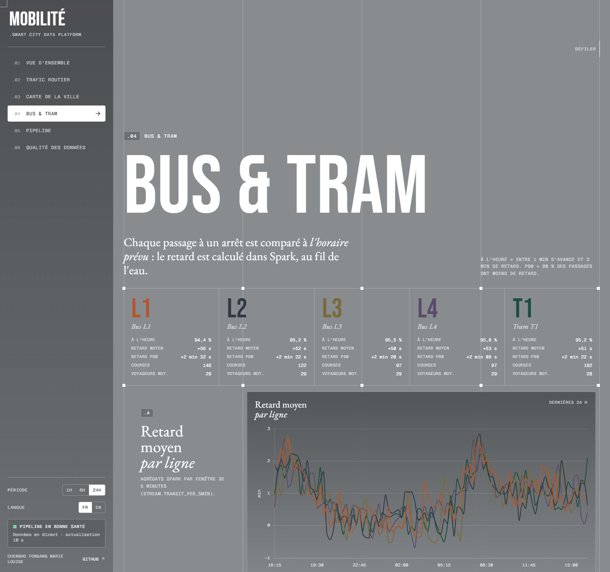

# Smart City Mobility Data Platform

[](README.md) [](README.en.md)

[](https://github.com/cheugs/Smart-City-Mobility-Data-Platform/actions/workflows/ci.yml)       

Student data engineering project: a streaming platform that ingests **simulated traffic sensors**,
**public transport events** and the **road network** of a sample city, and turns them into an operational
view of traffic and of bus and tram punctuality.

> All data is **synthetic**. The city is made up (a street grid placed on the coordinates of Limoges,
> France, so it can be drawn on a map). This project demonstrates a data platform; it does not claim
> to measure or predict real traffic.

**Live demo:** https://smart-city-mobility-data-platform-1.onrender.com  
*A copy of a real pipeline run (the full stack runs locally with Docker, see section 13).
The free service sleeps when unused: the first load can take a minute.*

**Author:** Chengho Fongang Marie Louise



**Contents:**
[1. Overview](#1-project-overview) ·
[2. Context](#2-business-context--mission) ·
[3. Objectives](#3-project-objectives) ·
[4. Architecture](#4-system-architecture) ·
[5. Data model](#5-data-model--event-schema) ·
[6. Challenges](#6-engineering-challenges--solutions) ·
[7. Processing](#7-data-processing--business-logic) ·
[8. Decisions](#8-engineering-decisions--trade-offs) ·
[9. Results](#9-results--performance-benchmarks) ·
[10. Dashboard](#10-dashboard--monitoring) ·
[11. Testing](#11-testing--reliability) ·
[12. Stack](#12-technology-stack) ·
[13. Installation](#13-installation--execution) ·
[14. Limitations](#14-limitations--future-improvements) ·
[15. Skills](#15-skills-demonstrated)

---

## 1. Project Overview

A Python producer simulates **60 traffic sensors** (one reading every 10 seconds) and **5 bus and tram
lines**, and sends the events to **Kafka**. A **PySpark Structured Streaming** job reads them continuously,
checks them, removes duplicates and computes time-window aggregates. The results go to
**PostgreSQL + PostGIS**, where the road network is stored as geometries. **Airflow** builds analytics
tables with **geospatial joins** (sensor → nearest road, sensor → district, stop → nearby sensor), detects
**missing sensors** and runs data-quality checks. **Grafana** monitors the pipeline, and a web dashboard
(FastAPI) gives the operational view of the city.

**In short:**
- **Start:** `docker compose up -d --build`
- **What it shows:** streaming ingestion, event-time windowed aggregates, a watermark for late events,
  geospatial joins, missing-sensor detection, monitoring, replay from Kafka, and recovery after a crash
  with no loss and no double counting
- **Tested:** 50 unit tests, 9 integration tests, 13 end-to-end tests on the Docker stack, 10 Airflow quality checks, and continuous integration (CI) that rebuilds everything on every push
- **Measured:** 1,000,000 events processed with 0 lost and 0 duplicated, about 1,300 to 1,800 events/s end to end; median latency of about 4.3 s under normal load
- **Checklist:** every acceptance criterion is linked to its proof in [docs/en/CHECKLIST.md](docs/en/CHECKLIST.md)

## 2. Business Context & Mission

A modern city continuously receives measurements from its road sensors and positions of its buses and
trams. The mobility control centre needs to know, within seconds, **where traffic slows down**, **which
lines are late** and **which sensors stopped answering**. This data is imperfect: readings arrive late or
out of order, some are sent twice, sensors break down, others send impossible values, and the message
format changes when the sensor software is updated.

**Mission:** build a small but realistic data platform that turns this imperfect stream into **reliable**
indicators, attached to the right place in the city: each reading is counted once, in the minute it really
happened, on the right road segment; invalid data is set aside with its reason; a silent sensor is detected
and tracked as an incident.

## 3. Project Objectives

1. Simulate realistic traffic sensors and public transport vehicles (rush hours, incidents, delays), including imperfect data on purpose.
2. Ingest them with Kafka and process them continuously with Spark Structured Streaming.
3. Compute windowed aggregates in **event time**, with a watermark for late data.
4. Store the road network in PostGIS and link each reading to its road segment and district with **geospatial joins**.
5. Detect **missing sensors** and track every outage as an incident (opened, closed).
6. Monitor the pipeline (throughput, latency, Kafka lag, invalid data, duplicates) with Grafana.
7. Orchestrate batch processing and quality checks with Airflow.
8. Show an operational view of traffic and public transport, available online.
9. Prove all of this with automated tests and performance measurements.

## 4. System Architecture

```
 ┌────────────┐   ┌───────────────────┐   ┌──────────────────────────┐   ┌───────────────────────┐
 │ producer   │──▶│ Kafka             │──▶│ PySpark Structured       │──▶│ PostgreSQL + PostGIS  │
 │ (Python)   │   │ traffic.readings  │   │ Streaming (4 queries)    │   │ city.*   network, geo │
 │ 60 sensors │   │ transit.events    │   │  parse + validate        │   │ raw.*    raw data     │
 │ 5 lines    │   │ 3 partitions      │   │  deduplicate             │   │ stream.* windows      │
 └────────────┘   │ 7 days            │   │  windows + watermark     │   │ monitoring.*          │
                  └───────────────────┘   └──────────────────────────┘   │ analytics.* (Airflow) │
                                                                          └──────────┬────────────┘
                     ┌──────────────────────────────┬──────────────────────────────┼────────────────┐
                     ▼                              ▼                              ▼                ▼
             ┌───────────────┐            ┌─────────────────┐            ┌─────────────────┐ ┌───────────┐
             │ Airflow       │            │ Grafana         │            │ Dashboard       │ │ Render    │
             │ geo joins     │            │ pipeline        │            │ FastAPI + map   │─▶ online    │
             │ marts, checks │            │ monitoring      │            │ (business view) │ │ demo      │
             │ silent sensors│            └─────────────────┘            └─────────────────┘ └───────────┘
             └───────────────┘
```

| Component | Role | Code |
|-----------|------|------|
| City generator | Creates the road network (84 segments), 6 districts, 60 sensors, 5 lines and 35 stops, as GeoJSON and SQL | [scripts/generate_city.py](scripts/generate_city.py) |
| Producer | Simulates traffic readings and stop events, with imperfect data on purpose | [producer/](producer/) |
| Kafka | Durable, replayable event log: 2 topics, 3 partitions each (key = `sensor_id` or `line_id`), 7-day retention | [docker-compose.yml](docker-compose.yml) |
| Spark | Parses, validates, deduplicates, builds event-time windows and writes idempotently | [spark/](spark/) |
| PostGIS | One layer per schema: `city`, `raw`, `stream`, `monitoring`, `analytics` | [sql/](sql/) |
| Airflow | DAG `mobility_analytics` (every 10 min): geospatial joins, marts, 10 quality checks. DAG `missing_sensor_detection` (every 5 min) | [airflow/](airflow/) |
| Grafana | Technical dashboard provisioned from files (17 panels) | [grafana/](grafana/) |
| Dashboard | FastAPI API + web page: overview, traffic, map, bus and tram, pipeline, quality | [dashboard/](dashboard/) |

### Data flow: the journey of one reading



**Step by step:**

1. **Creation.** Sensor `S017` measures 6 vehicles, an average speed of 31 km/h and 42 % occupancy over 10 seconds. The producer creates a message with a unique `event_id` and an `event_time` (when it was measured).
2. **Stored in Kafka.** The message goes to the `traffic.readings` topic with key `sensor_id`: all readings of one sensor land in the same partition, in order. Kafka keeps it 7 days, so it can be replayed.
3. **Read by Spark.** Every 5 seconds Spark reads the new messages as a micro-batch and saves its position (Kafka offsets) in a checkpoint.
4. **Checked.** Spark turns the JSON into columns and checks the quality rules (section 7). An invalid message goes to `raw.bad_events` with its reason.
5. **Two flows in parallel:**
   - **Raw flow:** every valid reading is written once to `raw.traffic_readings` (primary key `event_id`), and `stream.sensor_last_seen` remembers when each sensor was last heard from.
   - **Window flow:** valid readings are deduplicated and aggregated per sensor and per minute in **event time**. A late reading (up to 10 minutes) updates the minute it belongs to.
6. **Geospatial joins.** Every 10 minutes Airflow links each sensor to the **nearest road** (PostGIS KNN search) and to its **district** (`ST_Contains`), then computes congestion levels per segment, district and hour.
7. **Missing sensors.** Every 5 minutes Airflow opens an incident for each sensor silent for more than 5 minutes, and closes it when the sensor comes back.
8. **Display.** The dashboard reads PostGIS every 10 seconds; Grafana shows the pipeline health.

**Public transport events** follow the same path (topic `transit.events`): Spark computes the delay of each
stop event (`actual time - scheduled time`) and aggregates per line and per 5-minute window.

**Where a reading can end up:**

| The reading is… | Where it goes | Counted in windows? |
|-----------------|---------------|---------------------|
| Valid and new | `raw.traffic_readings` + its 1-minute window | Yes |
| A duplicate (same `event_id`) | Skipped, counted in `monitoring.batch_log.duplicates_skipped` | No (already counted) |
| Invalid or malformed | `raw.bad_events`, with `error_reason` | No |
| Late by less than 10 minutes | `raw.traffic_readings` + the window of the minute it happened | Yes |
| Late by more than 10 minutes | `raw.traffic_readings` only (kept, never lost) | No (window closed) |

**Traceability:** every raw row keeps its `kafka_partition` and `kafka_offset` (back to the exact message);
`monitoring.batch_log` records each micro-batch, `monitoring.stream_progress` each progress report with its
`run_id`, and `monitoring.pipeline_events` every start, restart, failure and replay.

## 5. Data Model & Event Schema

**Traffic reading, schema v1**

```json
{"event_id": "uuid", "schema_version": 1, "sensor_id": "S017", "event_time": "2026-11-08T07:45:10.000Z",
 "vehicle_count": 6, "avg_speed_kmh": 31.4, "occupancy_pct": 42.0}
```

**Schema v2** (new sensor firmware) adds two optional fields: `heavy_vehicle_count` and `firmware`.

**Stop event**

```json
{"event_id": "uuid", "schema_version": 1, "line_id": "T1", "vehicle_id": "T1-V07", "trip_id": "T1-202611080740",
 "stop_id": "T1-04", "event_type": "ARRIVAL", "scheduled_time": "2026-11-08T07:46:00.000Z",
 "event_time": "2026-11-08T07:48:15.000Z", "passengers": 87}
```

One layer per schema, so raw and transformed data never mix:

| Schema | Tables | Written by |
|--------|--------|------------|
| `city` | `districts` (polygons), `road_segments` (lines), `sensors` (points), `transit_lines`, `transit_stops` (points) | init SQL (generated by `generate_city.py`) |
| `raw` | `traffic_readings`, `transit_events` (each valid event once), `bad_events` (rejects + reason) | Spark |
| `stream` | `traffic_per_minute` (sensor × minute), `transit_per_5min` (line × 5 min), `sensor_last_seen` | Spark |
| `monitoring` | `batch_log`, `stream_progress` (throughput, Kafka lag), `pipeline_events`, `sensor_incidents`, `dq_results`, view `sensor_health` | Spark, Airflow |
| `analytics` | `sensor_context`, `stop_context` (geo joins), `traffic_segment_15min`, `traffic_district_hourly`, `traffic_hourly_profile`, `transit_line_hourly`, `transit_stop_delays`, `sensor_completeness_hourly` | Airflow |

**Indexes** (explained in [sql/01_schema.sql](sql/01_schema.sql)):
- **GiST** indexes on every geometry: used by the nearest-neighbour search (`<->`), `ST_Contains` and `ST_DWithin`.
- `raw.traffic_readings(event_time)` and `(sensor_id, event_time)`: the dashboard and the marts filter by period and sensor.
- `raw.traffic_readings(processed_at)`: the "latency over 5 minutes" KPI only reads recent rows.
- `raw.transit_events(line_id, event_time)` and `(stop_id, event_time)`: per-line and per-stop aggregates.
- Partial unique index `sensor_incidents(sensor_id) WHERE closed_at IS NULL`: at most one open incident per sensor.

## 6. Engineering Challenges & Solutions

| Challenge | Solution |
|-----------|----------|
| **Event time vs processing time:** a reading can arrive minutes after it happened | Windows are grouped by `event_time`. Three timestamps are stored (`event_time`, `kafka_time`, `processed_at`), so each delay can be measured |
| **Duplicates:** the source re-sends about 3 % of messages | `dropDuplicates(["event_id", "event_time"])` in Spark keeps windows correct; `ON CONFLICT (event_id) DO NOTHING` keeps the raw table clean; skipped copies are counted |
| **Late or out-of-order events** | 10-minute watermark: a late reading updates its old window. Beyond that it is no longer counted in windows, but it is stored in the raw table |
| **Linking a sensor to its road** | Sensors are placed 5-15 m from the road centre line (like a real roadside sensor). PostGIS finds the nearest segment (KNN `<->` + GiST index); a test checks that all 60 sensors are linked to the right segment |
| **Detecting a sensor that stopped talking** (missing data creates no event) | Spark remembers each sensor's last reading; a view compares that time with the clock (OK / DELAYED / SILENT); Airflow opens and closes incidents; hourly completeness measures the gaps |
| **Replay** | Kafka keeps 7 days. `scripts/replay.ps1` (or `replay.sh`) empties the tables written by Spark and the checkpoints: Spark re-reads the topics from the beginning |
| **Schema evolution** | The Spark schema has the fields of every version: v1 gets `NULL`, unknown fields from a future v3 are ignored, a missing `schema_version` means v1 |
| **Delivery guarantees** | See below. Database errors retried 3 times, container restarted after a crash, `failOnDataLoss=true` |

**Delivery guarantees, step by step:**

| Step | Guarantee | How |
|------|-----------|-----|
| Producer → Kafka | No duplicates from retries | `acks=all`, `enable.idempotence=true` |
| Source system | At least once (it may re-send) | 3 % simulated duplicates |
| Kafka → Spark | At least once | Offsets saved in the checkpoint; an unfinished batch is run again |
| Spark → PostGIS | Idempotent writes | Upserts on `event_id`, `(sensor_id, window_start)`, Kafka position; `batch_log` in the same transaction |
| **Result** | **Effectively exactly-once in the database** | At-least-once processing + idempotent writes |

**Key terms:**

| Term | Meaning in this project |
|------|-------------------------|
| Event time | When the reading was measured (`event_time`), not when we received it |
| Watermark | How long Spark waits for late readings (10 minutes) before closing a window |
| Micro-batch | Spark reads new messages every 5 seconds and processes them as one small batch |
| Checkpoint | Folder where Spark saves its progress so it can resume after a restart |
| Idempotent write | Writing the same data twice gives the same result as writing it once |
| Geospatial join | Linking two tables by position (distance, containment) instead of by a key |
| KNN | Nearest-neighbour search, here the road closest to a sensor |
| Relative speed | Average speed / speed limit: makes a 30 km/h street and a 70 km/h boulevard comparable |
| Kafka consumer lag | Number of messages in Kafka not processed yet |

## 7. Data Processing & Business Logic

**For each micro-batch** ([spark/transformations.py](spark/transformations.py)):
1. **Parse** the JSON into typed columns.
2. **Validate**: the first rule that fails is stored in `error_reason`.
3. **Store** valid events (duplicates skipped) and rejects with their reason.
4. **Aggregate** in event time: per sensor and minute (traffic), per line and 5 minutes (transport).

**Quality rules:**

| Rule (traffic) | `error_reason` |
|----------------|----------------|
| Invalid JSON | `malformed_json` |
| `event_id` / `sensor_id` / `event_time` missing | `missing_*` |
| Sensor not in `city.sensors` | `unknown_sensor` |
| Unreadable timestamp / more than 5 min in the future | `invalid_event_time` / `event_time_in_future` |
| Measurement missing | `missing_measurement` |
| Negative vehicle count / more than 300 in 10 s | `negative_vehicle_count` / `vehicle_count_too_high` |
| Speed outside 0-200 km/h | `speed_out_of_range` |
| Occupancy outside 0-100 % | `occupancy_out_of_range` |

| Rule (transport) | `error_reason` |
|------------------|----------------|
| Unknown line or stop | `unknown_line` / `unknown_stop` |
| Unreadable scheduled time | `invalid_scheduled_time` |
| Type other than ARRIVAL / DEPARTURE | `invalid_event_type` |
| Passengers outside 0-250 | `passengers_out_of_range` |
| Delay of more than 2 hours | `delay_out_of_range` |

The important rules are repeated as PostGIS **constraints** (`CHECK`, foreign keys to `city.*`) and
checked again by the **10 Airflow quality checks** ([airflow/sql/checks/](airflow/sql/checks/data_quality_checks.sql)).

**Business indicators:**

| Indicator | Rule |
|-----------|------|
| Congestion level of a segment | Relative speed ≥ 70 %: free flow · 45 to 70 %: dense · < 45 %: congested |
| Punctuality | Stop event between 1 min early and 3 min late |
| p90 delay | 90 % of stop events have less delay than this value |
| Sensor status | OK (< 60 s) · DELAYED (60 s to 5 min) · SILENT (> 5 min, incident opened) |
| Completeness | Readings received / readings expected (360 per hour per sensor) |
| Stop delay and nearby road | Each stop is linked to the closest sensor within 300 m (`ST_DWithin`) |

**Simulation model** ([producer/generator.py](producer/generator.py)): demand follows two peaks (around
8:00 and 17:30 local time), calmer at weekends; more demand means more vehicles, more occupancy and lower
speed; incidents slow one road down for 10 to 30 minutes; sensors sometimes break down for 6 to 25 minutes;
bus delays grow at rush hour.

## 8. Engineering Decisions & Trade-offs

| Decision | Why | Trade-off |
|----------|-----|-----------|
| `foreachBatch` + psycopg2 upserts instead of the JDBC connector | JDBC cannot do `ON CONFLICT`, and idempotent writes give exactly-once results | Each batch is collected on the driver: fine for thousands of events/s, not millions |
| Geospatial joins in PostGIS (Airflow), not in Spark | The road network is small and rarely changes; PostGIS has spatial indexes and proven functions | The sensor → road link is recomputed every 10 min, not on every event |
| Four streaming queries (raw + windows, for 2 topics) | The raw table must keep **every** reading, even beyond the watermark | Each query has its own checkpoint and writes |
| Missing-sensor detection in three steps (Spark, SQL view, Airflow) | Missing data produces no event: it has to be compared with the clock | The view is instant; incidents can be up to 5 minutes behind |
| Airflow + SQL files instead of dbt | Airflow is required by the brief and also orchestrates incident detection; one SQL file per mart stays modular | No automatic lineage or declarative tests like dbt |
| Full rebuild of the marts (DROP + CREATE) | Simple and idempotent: re-running a task breaks nothing | Expensive on very large tables (incremental models would fix it) |
| 10-minute watermark | Accepts the usual sensor delays | A window is only final after 10 minutes |
| JSON instead of Avro + Schema Registry | Easy to read and debug | Schema rules live in the code |
| Online demo from a copy | Kafka + Spark + Airflow do not fit in free hosting | The online demo is not live (the page says so) |

## 9. Results & Performance Benchmarks

Measured on a laptop: Docker Desktop with 12 CPUs and 8 GB, Spark in `local[4]`, all seven services
running at the same time. Details, resources and the bottleneck analysis are in
[docs/en/PERFORMANCE.md](docs/en/PERFORMANCE.md); raw results in [benchmarks/](benchmarks/).

| | 10,000 readings | 100,000 readings | 1,000,000 readings |
|---|---|---|---|
| Stored / lost / duplicated | 10,000 / **0** / **0** | 100,000 / **0** / **0** | 1,000,000 / **0** / **0** |
| End-to-end throughput | a single micro-batch (0.9 s) | **1,792 ev/s** | **1,271 ev/s** |
| Spark throughput (average / max per batch) | 1,744 ev/s | 1,697 / 2,760 ev/s | 1,783 / 4,821 ev/s |
| Producer → Kafka | 19,120 ev/s | 19,811 ev/s | 14,236 ev/s |
| Maximum Kafka lag | 0 | 66,025 | 920,007 |

- **Normal load** (60 sensors + 5 lines, about 6.5 events/s): Kafka to PostGIS latency of about **4.3 s** (median) and 22 s (p95).
- **24-hour history** (505,000 events on the first start): processed in 8 to 10 minutes.
- During a one-million-event spike, the waiting happens in Kafka (maximum lag of 920,000 messages, then back to 0), with no loss.
- **Main bottlenecks:** each reading is read twice (raw table + windows), and each batch is collected on the driver before writing.
- **Geospatial join:** PostGIS links all 60 sensors to the right road segment (maximum distance 14 m), checked by a test.

Run a benchmark:

```bash
python scripts/run_benchmark.py 100000
```

## 10. Dashboard & Monitoring

**Operational dashboard:** http://localhost:8000 (and the [online demo](https://smart-city-mobility-data-platform-1.onrender.com)).
A sidebar gives access to six pages, each answering one question:

| City map | Road traffic | Bus & tram |
|---|---|---|
|  |  |  |

| Page | Question it answers |
|------|---------------------|
| Overview | Is the city moving well, are buses on time, is the pipeline healthy? |
| Road traffic | Volumes and speeds by road type, hourly profile (rush hours), districts, slowest segments |
| City map | Each segment coloured by congestion, sensors (silent ones blink), lines and stops |
| Bus & tram | Punctuality, average and p90 delay per line, most delayed stops and speed of the nearby road |
| Pipeline | Throughput, Kafka lag, batch duration, latency, restarts, Airflow quality checks |
| Data quality | Rejects by reason, duplicates, late events, schema versions, sensor status, incidents, completeness |

- Data refreshed every 10 seconds; period filter (1 h, 6 h, 24 h); interface in French or English.
- Design: grey background, visible grid, large titles, frosted-glass cards, scroll animations and a cursor that follows the mouse; animations are turned off when the system asks for reduced motion.
- Works on phones: the sidebar becomes a menu.

**Grafana:** http://localhost:3000 (user `admin`, password in `.env`). The "Smart City - Pipeline monitoring"
dashboard is provisioned automatically: events per second, Kafka lag, p50/p95 latency, micro-batch
duration, rejects by reason, duplicates, late events, readings received vs expected, broken sensors,
pipeline log and quality checks.

**Airflow:** http://localhost:8080 (user `admin`); **Spark UI:** http://localhost:4041.

## 11. Testing & Reliability

| Level | What is tested | How to run |
|-------|----------------|------------|
| Unit (50) | Generator, every validation rule, window maths, city data, Airflow SQL files, dashboard API | `docker compose run --rm tests` |
| Integration (9) | Real streaming queries, one micro-batch at a time: out of order, late, beyond the watermark, duplicates, schema evolution, malformed data, restart from checkpoint, transport stream | (same command) |
| Quality checks (10) | Airflow, every 10 min: uniqueness, windows not inflated, no future events, valid measurements, consistent delays, sensors linked to a road and a district, v2 fields empty for v1 | Results in `monitoring.dq_results` |
| End to end (11) | On the running stack: ingestion, duplicates, rejects, schema versions, late events, bus delay, monitoring, Airflow DAG and geo join, sensor incidents, dashboard vs database, Spark restart | `pytest tests/e2e -m "not slow"` |
| Slow end to end (2) | PostGIS outage, full replay from Kafka (**the replay empties the tables!**) | `pytest tests/e2e -m slow` |

**Reliability scenarios tested:**
- Spark is restarted while events arrive: nothing is lost or counted twice, and the recovery is logged.
- PostGIS is stopped for 20 seconds: writes are retried, Spark restarts, and every event arrives.
- A full replay from Kafka gives back exactly the same events, still with no duplicates.
- A silent sensor opens an incident (only once, even if the DAG runs twice), which closes when it comes back.

**Continuous integration:** [.github/workflows/ci.yml](.github/workflows/ci.yml) runs the unit and integration
tests, then starts the whole Docker stack (Kafka, Spark, PostGIS, Airflow, Grafana, dashboard) and runs the
end-to-end tests, on every push.

## 12. Technology Stack

| Area | Tool | Version |
|------|------|---------|
| Language | Python | 3.12 (producer, dashboard), 3.11 (Airflow), 3.8 (Spark image) |
| Messaging | Apache Kafka (KRaft, no Zookeeper) | 3.8.0 |
| Stream processing | PySpark Structured Streaming + RocksDB state store | 3.5.3 |
| Database | PostgreSQL + PostGIS | 16 / 3.4 |
| Orchestration | Apache Airflow (LocalExecutor) | 2.10.3 |
| Monitoring | Grafana | 11.3 |
| Dashboard | FastAPI, Chart.js, Leaflet | 0.115 / 4.4 / 1.9 |
| Containers | Docker Compose | v2 |
| Tests and CI | pytest, GitHub Actions | 8.3 |
| Demo hosting | Render (free plan) | |

## 13. Installation & Execution

You need **Docker Desktop** with at least **6 GB of memory** (Settings → Resources).

**1. Create the configuration file** and put your own passwords in it:

```bash
cp .env.example .env
```

**2. Start everything** (the first start takes a few minutes: images and Spark's Kafka connector are downloaded):

```bash
docker compose up -d --build
```

**3. 24 hours of history (automatic).** On the very first start, while Kafka is still empty, the producer
first simulates the last 24 hours (`BACKFILL_HOURS` in `.env`, `0` to turn it off), in time order, then
switches to live. Spark processes this history in a few minutes, so the rush hours are visible straight away.
(The history must go before live data, otherwise the watermark would treat it as too late.)

**4. Open the interfaces:**

| Interface | Address |
|-----------|---------|
| Dashboard | http://localhost:8000 |
| Grafana | http://localhost:3000 |
| Airflow | http://localhost:8080 |
| Spark UI | http://localhost:4041 |
| PostGIS (from your computer) | `localhost:5433` |

Ports 5433 (PostGIS), 29093 (Kafka) and 4041 (Spark) were chosen so they do not clash with a PostgreSQL or
Kafka already installed.

**Run the tests:**

```bash
docker compose run --rm tests
```

```bash
pip install -r requirements-dev.txt
```

```bash
pytest tests/e2e -m "not slow"
```

**Run a benchmark:**

```bash
python scripts/run_benchmark.py 100000
```

**Replay everything from Kafka** (Windows; on Mac or Linux: `sh scripts/replay.sh`):

```powershell
.\scripts\replay.ps1
```

**Stop:**

```bash
docker compose down
```

(`docker compose down -v` also deletes the data, the Kafka topics and the checkpoints.)

**Configuration:** every setting is an environment variable in `.env` (passwords, watermark, trigger
interval, batch size, Spark cores). No secret is in the code.

**Change the city:** edit [scripts/generate_city.py](scripts/generate_city.py), run
`python scripts/generate_city.py`, then `docker compose down -v` and `docker compose up -d --build`.

## 14. Limitations & Future Improvements

**Known limitations:**
- The data is simulated: the traffic model is deliberately simple (one demand curve, one speed/density relation).
- A single Kafka broker and Spark in local mode: no high availability.
- `foreachBatch` collects each batch on the driver: the main bottleneck beyond a few thousand events per second.
- The Airflow marts are fully rebuilt every 10 minutes and limited to the last 7 days.
- The online demo is a frozen copy of one run, not a live stream.
- No schema registry: compatibility is checked by tests, not enforced by a tool.
- The congestion level only uses relative speed (no road-capacity model).

**Possible improvements:**
- Avro + Schema Registry to enforce schema compatibility.
- Distributed writes (JDBC into a staging table + `MERGE`) to go beyond the driver limit.
- Incremental marts, raw tables partitioned by day.
- Several Kafka brokers, Spark on a cluster, Grafana alerts sent by e-mail.
- Real open data (road counts, GTFS-RT from a transport network) instead of the simulator.
- Short-term traffic forecasting from the history.

## 15. Skills Demonstrated

- **Streaming:** Kafka (topics, partitions, keys, retention), Spark Structured Streaming (micro-batches, event time, windows, watermark, stateful deduplication, checkpoints, `foreachBatch`).
- **Geospatial data:** PostGIS, geometries (points, lines, polygons), GiST indexes, nearest neighbour (KNN), `ST_Contains`, `ST_DWithin`, distances in metres with `geography`, GeoJSON.
- **Modelling:** raw / stream / analytics separation, constraints, justified indexes, idempotent writes.
- **Data quality:** validation rules, reject table, automatic checks, missing-data detection.
- **Orchestration:** Airflow DAGs, task dependencies, automatic retries, idempotent tasks.
- **Reliability:** crash recovery, replay, documented and tested delivery guarantees.
- **Monitoring:** throughput, latency and Kafka lag metrics, Grafana provisioned from files.
- **Visualisation:** FastAPI API, responsive web dashboard with charts and an interactive map.
- **Engineering:** Docker Compose, externalised configuration, unit, integration and end-to-end tests, GitHub Actions CI, free deployment on Render, bilingual documentation.
