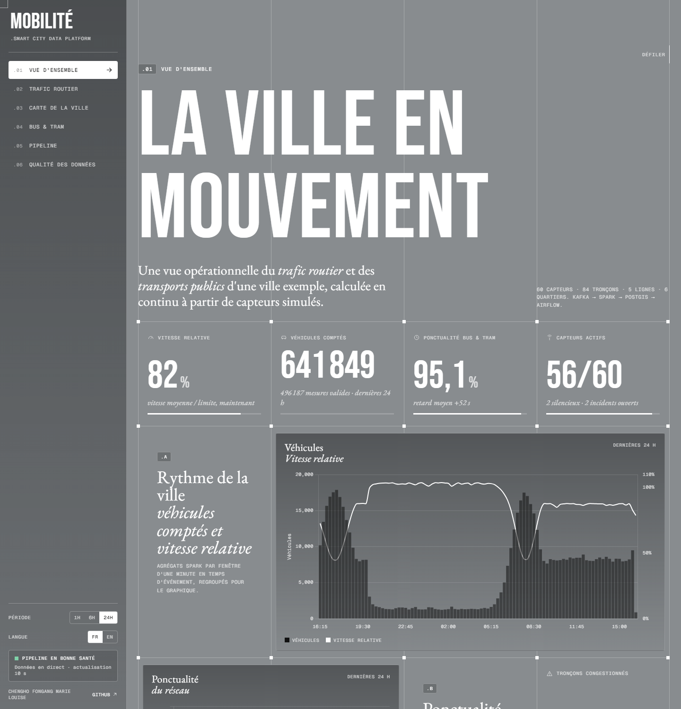
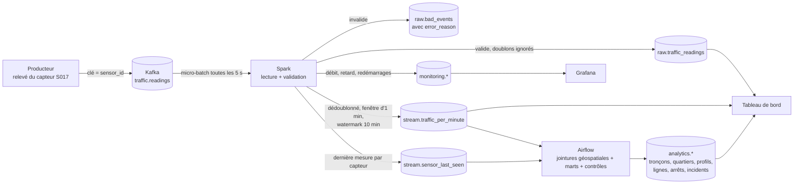
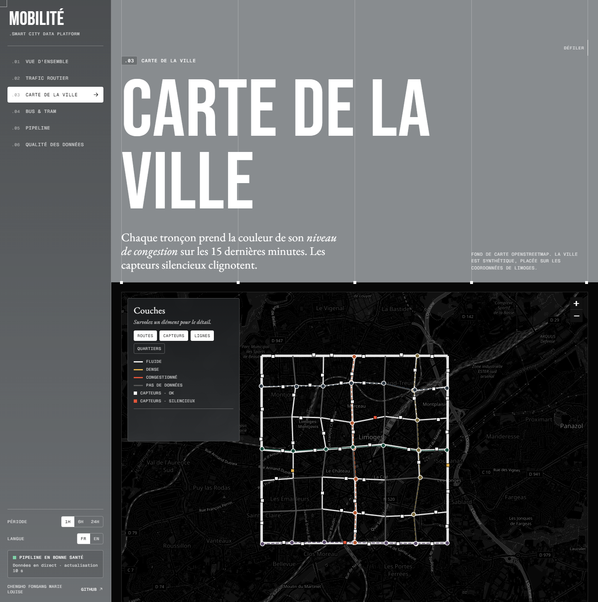
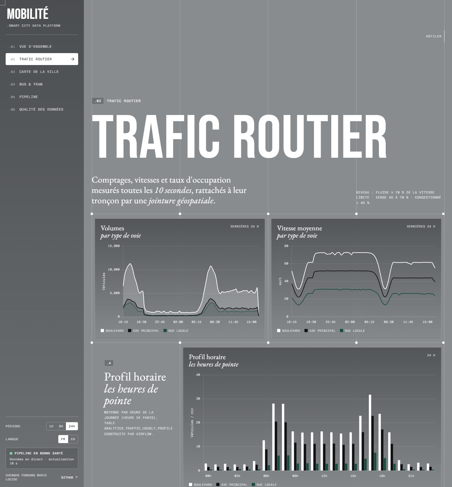
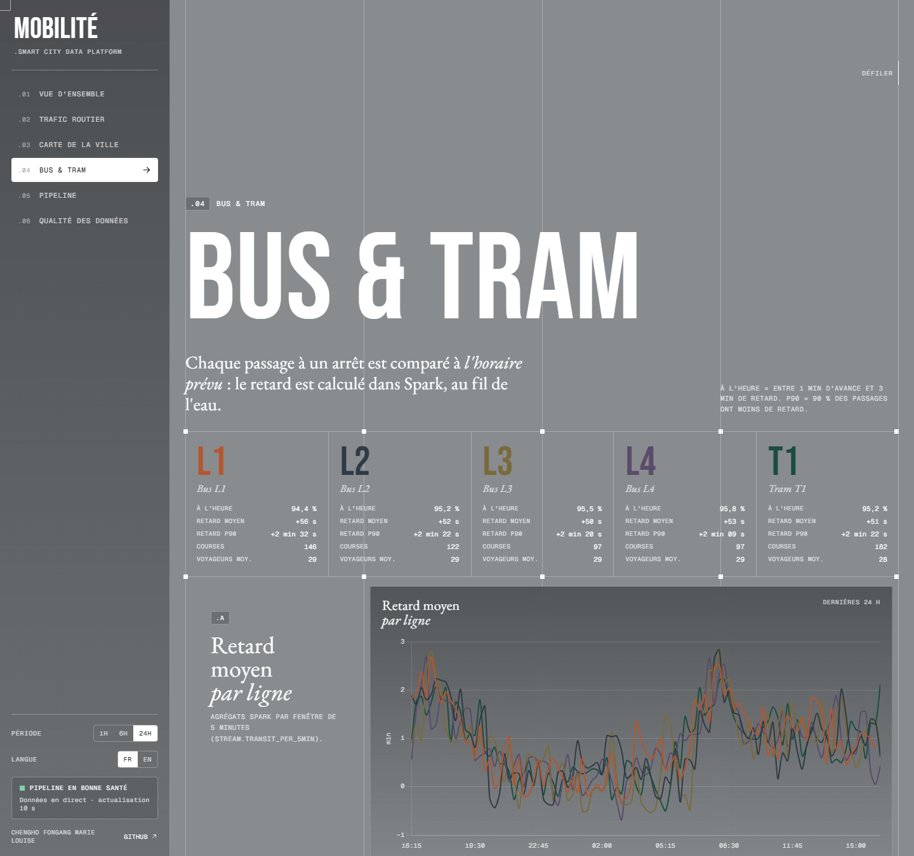

# Plateforme de données de mobilité urbaine (Smart City)

[](README.md) [](README.en.md)

[](https://github.com/cheugs/Smart-City-Mobility-Data-Platform/actions/workflows/ci.yml)       

Projet étudiant de data engineering : une plateforme de streaming qui ingère des **capteurs de trafic
simulés**, des **événements de transport public** et le **réseau routier** d'une ville exemple, puis
produit une vue opérationnelle du trafic et de la ponctualité des bus et du tram.

> Toutes les données sont **synthétiques**. La ville est inventée (une grille de rues placée sur les
> coordonnées de Limoges pour pouvoir l'afficher sur une carte). Ce projet démontre une plateforme de
> données ; il ne prétend pas mesurer ni prévoir le trafic réel.

**Démo en ligne :** https://smart-city-mobility-data-platform-1.onrender.com  
*Une copie d'une vraie exécution du pipeline (la chaîne complète tourne en local avec Docker, voir la section 13).
Le service gratuit se met en veille : le premier chargement peut prendre une minute.*

**Auteure :** Chengho Fongang Marie Louise



**Sommaire :**
[1. Présentation](#1-présentation-du-projet) ·
[2. Contexte](#2-contexte-métier-et-mission) ·
[3. Objectifs](#3-objectifs-du-projet) ·
[4. Architecture](#4-architecture-du-système) ·
[5. Modèle de données](#5-modèle-de-données-et-schéma-des-événements) ·
[6. Défis](#6-défis-techniques-et-solutions) ·
[7. Traitement](#7-traitement-des-données-et-logique-métier) ·
[8. Choix](#8-choix-techniques-et-compromis) ·
[9. Résultats](#9-résultats-et-tests-de-performance) ·
[10. Tableau de bord](#10-tableau-de-bord-et-supervision) ·
[11. Tests](#11-tests-et-fiabilité) ·
[12. Technologies](#12-technologies-utilisées) ·
[13. Installation](#13-installation-et-exécution) ·
[14. Limites](#14-limites-et-améliorations-possibles) ·
[15. Compétences](#15-compétences-démontrées)

---

## 1. Présentation du projet

Un producteur Python simule **60 capteurs de trafic** (un relevé toutes les 10 secondes) et **5 lignes de
bus et de tram**, et envoie les événements à **Kafka**. Un job **PySpark Structured Streaming** les lit en
continu, les vérifie, supprime les doublons et calcule des agrégats par fenêtre de temps. Les résultats
vont dans **PostgreSQL + PostGIS**, où le réseau routier est stocké sous forme de géométries.
**Airflow** construit des tables d'analyse avec des **jointures géospatiales** (capteur → route la plus
proche, capteur → quartier, arrêt → capteur voisin), détecte les **capteurs manquants** et lance des
contrôles de qualité. **Grafana** supervise le pipeline, et un tableau de bord web (FastAPI) donne la
vue opérationnelle de la ville.

**En bref :**
- **Lancement :** `docker compose up -d --build`
- **Ce que le projet démontre :** ingestion en streaming, agrégats par fenêtre en temps d'événement,
  watermark pour les événements en retard, jointures géospatiales, détection des capteurs manquants,
  supervision, rejeu depuis Kafka et reprise après panne sans perte ni double comptage
- **Testé :** 50 tests unitaires, 9 tests d'intégration, 13 tests de bout en bout sur la chaîne Docker, 10 contrôles qualité Airflow, et une intégration continue (CI) qui reconstruit tout à chaque push
- **Mesuré :** 1 000 000 d'événements traités avec 0 perte et 0 doublon, environ 1 300 à 1 800 événements/s de bout en bout ; latence médiane d'environ 4,3 s en charge normale
- **Checklist :** chaque critère d'acceptation est relié à sa preuve dans [docs/CHECKLIST.md](docs/CHECKLIST.md)

## 2. Contexte métier et mission

Une ville moderne reçoit en continu des mesures de ses capteurs routiers et des positions de ses bus et
tramways. Le centre de gestion de la mobilité doit savoir, en quelques secondes, **où le trafic ralentit**,
**quelles lignes sont en retard** et **quels capteurs ne répondent plus**. Ces données sont imparfaites :
des mesures arrivent en retard ou dans le désordre, certaines sont envoyées deux fois, des capteurs
tombent en panne, d'autres envoient des valeurs impossibles, et le format des messages évolue quand le
logiciel des capteurs est mis à jour.

**Mission :** construire une petite plateforme de données, mais réaliste, qui transforme ce flux imparfait
en indicateurs **fiables**, rattachés au bon endroit de la ville : chaque mesure est comptée une seule
fois, dans la minute où elle a vraiment eu lieu, sur le bon tronçon de route ; les données invalides sont
mises de côté avec leur motif ; un capteur silencieux est détecté et suivi comme un incident.

## 3. Objectifs du projet

1. Simuler des capteurs de trafic et des véhicules de transport public réalistes (heures de pointe, incidents, retards), y compris des données imparfaites volontairement.
2. Les ingérer avec Kafka et les traiter en continu avec Spark Structured Streaming.
3. Calculer des agrégats par fenêtre en **temps d'événement**, avec un watermark pour les retards.
4. Stocker le réseau routier dans PostGIS et relier chaque mesure à son tronçon et à son quartier par des **jointures géospatiales**.
5. Détecter les **capteurs manquants** et suivre chaque panne comme un incident (ouverture, fermeture).
6. Superviser le pipeline (débit, latence, retard Kafka, données invalides, doublons) avec Grafana.
7. Orchestrer les traitements batch et les contrôles de qualité avec Airflow.
8. Afficher une vue opérationnelle du trafic et des transports publics, accessible en ligne.
9. Prouver le tout par des tests automatisés et des mesures de performance.

## 4. Architecture du système

```
 ┌────────────┐   ┌───────────────────┐   ┌──────────────────────────┐   ┌───────────────────────┐
 │ producteur │──▶│ Kafka             │──▶│ PySpark Structured       │──▶│ PostgreSQL + PostGIS  │
 │ (Python)   │   │ traffic.readings  │   │ Streaming (4 requêtes)   │   │ city.*   réseau, géo  │
 │ 60 capteurs│   │ transit.events    │   │  lecture + validation    │   │ raw.*    données brutes│
 │ 5 lignes   │   │ 3 partitions      │   │  dédoublonnage           │   │ stream.* fenêtres     │
 └────────────┘   │ 7 jours           │   │  fenêtres + watermark    │   │ monitoring.*          │
                  └───────────────────┘   └──────────────────────────┘   │ analytics.* (Airflow) │
                                                                          └──────────┬────────────┘
                     ┌──────────────────────────────┬──────────────────────────────┼────────────────┐
                     ▼                              ▼                              ▼                ▼
             ┌───────────────┐            ┌─────────────────┐            ┌─────────────────┐ ┌───────────┐
             │ Airflow       │            │ Grafana         │            │ Tableau de bord │ │ Render    │
             │ jointures géo │            │ supervision     │            │ FastAPI + carte │─▶ démo en  │
             │ marts, qualité│            │ du pipeline     │            │ (vue métier)    │ │ ligne     │
             │ capteurs muets│            └─────────────────┘            └─────────────────┘ └───────────┘
             └───────────────┘
```

| Composant | Rôle | Code |
|-----------|------|------|
| Générateur de la ville | Crée le réseau routier (84 tronçons), 6 quartiers, 60 capteurs, 5 lignes et 35 arrêts, en GeoJSON et en SQL | [scripts/generate_city.py](scripts/generate_city.py) |
| Producteur | Simule les relevés de trafic et les passages aux arrêts, avec des données imparfaites volontaires | [producer/](producer/) |
| Kafka | Journal d'événements durable et rejouable : 2 topics, 3 partitions chacun (clé = `sensor_id` ou `line_id`), rétention de 7 jours | [docker-compose.yml](docker-compose.yml) |
| Spark | Lit, valide, supprime les doublons, calcule les fenêtres en temps d'événement et écrit de façon idempotente | [spark/](spark/) |
| PostGIS | Une couche par schéma : `city`, `raw`, `stream`, `monitoring`, `analytics` | [sql/](sql/) |
| Airflow | DAG `mobility_analytics` (toutes les 10 min) : jointures géospatiales, marts, 10 contrôles qualité. DAG `missing_sensor_detection` (toutes les 5 min) | [airflow/](airflow/) |
| Grafana | Tableau de bord technique provisionné depuis des fichiers (17 panneaux) | [grafana/](grafana/) |
| Tableau de bord | API FastAPI + page web : vue d'ensemble, trafic, carte, bus et tram, pipeline, qualité | [dashboard/](dashboard/) |

### Flux de données : le parcours d'une mesure



**Étape par étape :**

1. **Création.** Le capteur `S017` mesure 6 véhicules, une vitesse moyenne de 31 km/h et un taux d'occupation de 42 % pendant 10 secondes. Le producteur crée un message avec un identifiant unique `event_id` et un `event_time` (le moment de la mesure).
2. **Stockage dans Kafka.** Le message va dans le topic `traffic.readings` avec la clé `sensor_id` : toutes les mesures d'un capteur arrivent dans la même partition, dans l'ordre. Kafka garde le message 7 jours, ce qui permet de le rejouer.
3. **Lecture par Spark.** Toutes les 5 secondes, Spark lit les nouveaux messages en un micro-batch et enregistre sa position (offsets Kafka) dans un checkpoint.
4. **Vérification.** Spark transforme le JSON en colonnes et vérifie les règles de qualité (section 7). Un message invalide part dans `raw.bad_events` avec son motif.
5. **Deux flux en parallèle :**
   - **Flux brut :** chaque mesure valide est écrite une seule fois dans `raw.traffic_readings` (clé primaire `event_id`), et `stream.sensor_last_seen` retient l'heure de la dernière mesure de chaque capteur.
   - **Flux des fenêtres :** les mesures valides sont dédoublonnées et agrégées par capteur et par minute en **temps d'événement**. Une mesure en retard (jusqu'à 10 minutes) met à jour la minute à laquelle elle appartient.
6. **Jointures géospatiales.** Toutes les 10 minutes, Airflow relie chaque capteur à la **route la plus proche** (recherche KNN de PostGIS) et à son **quartier** (`ST_Contains`), puis calcule les niveaux de congestion par tronçon, par quartier et par heure.
7. **Capteurs manquants.** Toutes les 5 minutes, Airflow ouvre un incident pour chaque capteur silencieux depuis plus de 5 minutes, et le ferme quand le capteur revient.
8. **Affichage.** Le tableau de bord lit PostGIS toutes les 10 secondes ; Grafana affiche la santé du pipeline.

Les **événements de transport public** suivent le même chemin (topic `transit.events`) : Spark calcule le
retard de chaque passage (`heure réelle - heure prévue`) et des agrégats par ligne et par fenêtre de 5 minutes.

**Où peut finir une mesure :**

| La mesure est… | Où elle va | Comptée dans les fenêtres ? |
|----------------|------------|-----------------------------|
| Valide et nouvelle | `raw.traffic_readings` + sa fenêtre d'une minute | Oui |
| Un doublon (même `event_id`) | Ignorée, comptée dans `monitoring.batch_log.duplicates_skipped` | Non (déjà comptée) |
| Invalide ou mal formée | `raw.bad_events`, avec `error_reason` | Non |
| En retard de moins de 10 minutes | `raw.traffic_readings` + la fenêtre de la minute où elle a eu lieu | Oui |
| En retard de plus de 10 minutes | `raw.traffic_readings` seulement (gardée, jamais perdue) | Non (fenêtre fermée) |

**Traçabilité :** chaque ligne brute garde sa `kafka_partition` et son `kafka_offset` (on peut remonter au
message exact) ; `monitoring.batch_log` enregistre chaque micro-batch, `monitoring.stream_progress` chaque
rapport de progression avec son `run_id`, et `monitoring.pipeline_events` chaque démarrage, reprise, panne et rejeu.

## 5. Modèle de données et schéma des événements

**Relevé de trafic, schéma v1**

```json
{"event_id": "uuid", "schema_version": 1, "sensor_id": "S017", "event_time": "2026-11-08T07:45:10.000Z",
 "vehicle_count": 6, "avg_speed_kmh": 31.4, "occupancy_pct": 42.0}
```

Le **schéma v2** (nouveau logiciel des capteurs) ajoute deux champs facultatifs : `heavy_vehicle_count` et `firmware`.

**Passage à un arrêt**

```json
{"event_id": "uuid", "schema_version": 1, "line_id": "T1", "vehicle_id": "T1-V07", "trip_id": "T1-202611080740",
 "stop_id": "T1-04", "event_type": "ARRIVAL", "scheduled_time": "2026-11-08T07:46:00.000Z",
 "event_time": "2026-11-08T07:48:15.000Z", "passengers": 87}
```

Une couche par schéma, pour que les données brutes et transformées ne se mélangent jamais :

| Schéma | Tables | Écrit par |
|--------|--------|-----------|
| `city` | `districts` (polygones), `road_segments` (lignes), `sensors` (points), `transit_lines`, `transit_stops` (points) | init SQL (généré par `generate_city.py`) |
| `raw` | `traffic_readings`, `transit_events` (chaque événement valide une seule fois), `bad_events` (rejets + motif) | Spark |
| `stream` | `traffic_per_minute` (capteur × minute), `transit_per_5min` (ligne × 5 min), `sensor_last_seen` | Spark |
| `monitoring` | `batch_log`, `stream_progress` (débit, retard Kafka), `pipeline_events`, `sensor_incidents`, `dq_results`, vue `sensor_health` | Spark, Airflow |
| `analytics` | `sensor_context`, `stop_context` (jointures géo), `traffic_segment_15min`, `traffic_district_hourly`, `traffic_hourly_profile`, `transit_line_hourly`, `transit_stop_delays`, `sensor_completeness_hourly` | Airflow |

**Index** (expliqués dans [sql/01_schema.sql](sql/01_schema.sql)) :
- Index **GiST** sur toutes les géométries : utilisés par la recherche du plus proche voisin (`<->`), `ST_Contains` et `ST_DWithin`.
- `raw.traffic_readings(event_time)` et `(sensor_id, event_time)` : le tableau de bord et les marts filtrent par période et par capteur.
- `raw.traffic_readings(processed_at)` : le KPI « latence sur 5 minutes » ne lit que les lignes récentes.
- `raw.transit_events(line_id, event_time)` et `(stop_id, event_time)` : agrégats par ligne et par arrêt.
- Index unique partiel `sensor_incidents(sensor_id) WHERE closed_at IS NULL` : au plus un incident ouvert par capteur.

## 6. Défis techniques et solutions

| Défi | Solution |
|------|----------|
| **Temps d'événement ou temps de traitement :** une mesure peut arriver plusieurs minutes après avoir eu lieu | Les fenêtres sont groupées par `event_time`. Trois horodatages sont stockés (`event_time`, `kafka_time`, `processed_at`), ce qui permet de mesurer chaque délai |
| **Doublons :** la source renvoie environ 3 % des messages | `dropDuplicates(["event_id", "event_time"])` dans Spark garde des fenêtres justes ; `ON CONFLICT (event_id) DO NOTHING` garde la table brute propre ; les copies ignorées sont comptées |
| **Événements en retard ou dans le désordre** | Watermark de 10 minutes : une mesure en retard met à jour son ancienne fenêtre. Au-delà, elle n'est plus comptée dans les fenêtres, mais elle est stockée dans la table brute |
| **Rattacher un capteur à sa route** | Les capteurs sont placés à 5-15 m de l'axe de la route (comme un vrai capteur en bord de voie). PostGIS trouve le tronçon le plus proche (KNN `<->` + index GiST) ; un test vérifie que les 60 capteurs sont rattachés au bon tronçon |
| **Détecter un capteur qui ne parle plus** (une absence de données ne crée aucun événement) | Spark retient la dernière mesure de chaque capteur ; une vue compare cette heure à l'horloge (OK / DELAYED / SILENT) ; Airflow ouvre et ferme les incidents ; la complétude horaire mesure les trous |
| **Rejeu** | Kafka garde 7 jours. `scripts/replay.ps1` (ou `replay.sh`) vide les tables écrites par Spark et les checkpoints : Spark relit les topics depuis le début |
| **Évolution du schéma** | Le schéma Spark contient les champs de toutes les versions : les v1 reçoivent `NULL`, les champs inconnus d'une future v3 sont ignorés, un `schema_version` absent signifie v1 |
| **Garanties de livraison** | Voir ci-dessous. Erreurs de base réessayées 3 fois, conteneur redémarré après une panne, `failOnDataLoss=true` |

**Garanties de livraison, étape par étape :**

| Étape | Garantie | Comment |
|-------|----------|---------|
| Producteur → Kafka | Pas de doublons dus aux nouvelles tentatives | `acks=all`, `enable.idempotence=true` |
| Système source | Au moins une fois (il peut renvoyer) | 3 % de doublons simulés |
| Kafka → Spark | Au moins une fois | Offsets sauvegardés dans le checkpoint ; un batch non terminé est relancé |
| Spark → PostGIS | Écritures idempotentes | Upserts sur `event_id`, `(sensor_id, window_start)`, position Kafka ; `batch_log` dans la même transaction |
| **Résultat** | **Équivalent à « exactement une fois » dans la base** | Traitement « au moins une fois » + écritures idempotentes |

**Termes clés :**

| Terme | Signification dans ce projet |
|-------|------------------------------|
| Temps d'événement | Le moment de la mesure (`event_time`), et non celui de sa réception |
| Watermark | Combien de temps Spark attend les mesures en retard (10 minutes) avant de fermer une fenêtre |
| Micro-batch | Spark lit les nouveaux messages toutes les 5 secondes et les traite en un petit lot |
| Checkpoint | Dossier où Spark sauvegarde sa progression pour reprendre après un redémarrage |
| Écriture idempotente | Écrire deux fois les mêmes données donne le même résultat qu'une seule fois |
| Jointure géospatiale | Relier deux tables par la position (distance, inclusion) plutôt que par une clé |
| KNN | Recherche du plus proche voisin (*k nearest neighbours*), ici la route la plus proche d'un capteur |
| Vitesse relative | Vitesse moyenne / vitesse limite : rend comparables une rue à 30 km/h et un boulevard à 70 km/h |
| Retard du consommateur Kafka | Nombre de messages présents dans Kafka mais pas encore traités |

## 7. Traitement des données et logique métier

**Pour chaque micro-batch** ([spark/transformations.py](spark/transformations.py)) :
1. **Lire** le JSON et le transformer en colonnes typées.
2. **Valider** : la première règle non respectée est enregistrée dans `error_reason`.
3. **Stocker** les événements valides (doublons ignorés) et les rejets avec leur motif.
4. **Agréger** en temps d'événement : par capteur et par minute (trafic), par ligne et par 5 minutes (transport).

**Règles de qualité :**

| Règle (trafic) | `error_reason` |
|----------------|----------------|
| JSON invalide | `malformed_json` |
| `event_id` / `sensor_id` / `event_time` absent | `missing_*` |
| Capteur inconnu de `city.sensors` | `unknown_sensor` |
| Horodatage illisible / plus de 5 min dans le futur | `invalid_event_time` / `event_time_in_future` |
| Mesure absente | `missing_measurement` |
| Nombre de véhicules négatif / supérieur à 300 en 10 s | `negative_vehicle_count` / `vehicle_count_too_high` |
| Vitesse hors de 0-200 km/h | `speed_out_of_range` |
| Occupation hors de 0-100 % | `occupancy_out_of_range` |

| Règle (transport) | `error_reason` |
|-------------------|----------------|
| Ligne ou arrêt inconnu | `unknown_line` / `unknown_stop` |
| Heure prévue illisible | `invalid_scheduled_time` |
| Type différent de ARRIVAL / DEPARTURE | `invalid_event_type` |
| Voyageurs hors de 0-250 | `passengers_out_of_range` |
| Retard de plus de 2 heures | `delay_out_of_range` |

Les règles importantes sont répétées en **contraintes** PostGIS (`CHECK`, clés étrangères vers `city.*`)
et revérifiées par les **10 contrôles qualité** d'Airflow ([airflow/sql/checks/](airflow/sql/checks/data_quality_checks.sql)).

**Indicateurs métier :**

| Indicateur | Règle |
|------------|-------|
| Niveau de congestion d'un tronçon | Vitesse relative ≥ 70 % : fluide · 45 à 70 % : dense · < 45 % : congestionné |
| Ponctualité | Passage entre 1 min d'avance et 3 min de retard |
| Retard p90 | 90 % des passages ont moins de retard que cette valeur |
| Statut d'un capteur | OK (< 60 s) · DELAYED (60 s à 5 min) · SILENT (> 5 min, incident ouvert) |
| Complétude | Mesures reçues / mesures attendues (360 par heure et par capteur) |
| Retard d'un arrêt et route voisine | Chaque arrêt est relié au capteur le plus proche à moins de 300 m (`ST_DWithin`) |

**Modèle de simulation** ([producer/generator.py](producer/generator.py)) : la demande suit deux pics
(vers 8 h et 17 h 30, heure locale), plus calmes le week-end ; plus de demande donne plus de véhicules,
plus d'occupation et une vitesse plus basse ; des incidents ralentissent une route pendant 10 à 30 minutes ;
les capteurs tombent parfois en panne pendant 6 à 25 minutes ; le retard des bus augmente aux heures de pointe.

## 8. Choix techniques et compromis

| Choix | Pourquoi | Compromis |
|-------|----------|-----------|
| `foreachBatch` + upserts psycopg2 au lieu du connecteur JDBC | JDBC ne sait pas faire `ON CONFLICT`, et les écritures idempotentes donnent des résultats « exactement une fois » | Chaque batch est rapatrié sur le driver : suffisant pour des milliers d'événements/s, pas pour des millions |
| Jointures géospatiales dans PostGIS (Airflow) et non dans Spark | Le réseau routier est petit et change rarement ; PostGIS a des index spatiaux et des fonctions éprouvées | Le lien capteur → route est recalculé toutes les 10 min, pas à chaque événement |
| Quatre requêtes de streaming (brut + fenêtres, pour 2 topics) | La table brute doit garder **toutes** les mesures, même au-delà du watermark | Chaque requête a son propre checkpoint et ses propres écritures |
| Détection des capteurs manquants en trois étapes (Spark, vue SQL, Airflow) | Une absence de données ne produit aucun événement : il faut comparer avec l'horloge | La vue est instantanée ; les incidents ont jusqu'à 5 minutes de décalage |
| Airflow + fichiers SQL au lieu de dbt | Airflow est demandé par le sujet et orchestre aussi la détection des incidents ; un fichier SQL par mart reste modulaire | Pas de lignage automatique ni de tests déclaratifs comme dbt |
| Reconstruction complète des marts (DROP + CREATE) | Simple et idempotent : relancer une tâche ne casse rien | Coûteux sur de très grosses tables (des modèles incrémentaux le feraient) |
| Watermark de 10 minutes | Accepte les retards habituels des capteurs | Une fenêtre n'est définitive qu'après 10 minutes |
| JSON plutôt qu'Avro + Schema Registry | Facile à lire et à déboguer | Les règles de schéma sont dans le code |
| Démo en ligne à partir d'une copie | Kafka + Spark + Airflow ne tiennent pas dans un hébergement gratuit | La démo en ligne n'est pas en direct (c'est indiqué sur la page) |

## 9. Résultats et tests de performance

Mesuré sur un ordinateur portable : Docker Desktop avec 12 CPU et 8 Go, Spark en `local[4]`, les sept services
lancés en même temps. Le détail, les ressources et l'analyse des goulots d'étranglement sont dans
[docs/PERFORMANCE.md](docs/PERFORMANCE.md) ; les résultats bruts dans [benchmarks/](benchmarks/).

| | 10 000 relevés | 100 000 relevés | 1 000 000 de relevés |
|---|---|---|---|
| Stockés / perdus / en double | 10 000 / **0** / **0** | 100 000 / **0** / **0** | 1 000 000 / **0** / **0** |
| Débit de bout en bout | un seul micro-batch (0,9 s) | **1 792 év./s** | **1 271 év./s** |
| Débit de Spark (moyenne / max par batch) | 1 744 év./s | 1 697 / 2 760 év./s | 1 783 / 4 821 év./s |
| Producteur → Kafka | 19 120 év./s | 19 811 év./s | 14 236 év./s |
| Retard Kafka maximal | 0 | 66 025 | 920 007 |

- **Charge normale** (60 capteurs + 5 lignes, environ 6,5 événements/s) : latence de Kafka à PostGIS d'environ **4,3 s** (médiane) et 22 s (p95).
- **Historique de 24 h** (505 000 événements au premier démarrage) : traité en 8 à 10 minutes.
- Pendant un pic d'un million d'événements, l'attente se fait dans Kafka (retard maximal de 920 000 messages, puis retour à 0), sans perte.
- **Principaux goulots d'étranglement :** chaque relevé est lu deux fois (table brute + fenêtres), et chaque batch est rapatrié sur le driver avant l'écriture.
- **Jointure géospatiale :** PostGIS rattache les 60 capteurs au bon tronçon (distance maximale 14 m), vérifié par un test.

Lancer un test de performance :

```bash
python scripts/run_benchmark.py 100000
```

## 10. Tableau de bord et supervision

**Tableau de bord opérationnel** : http://localhost:8000 (et la [démo en ligne](https://smart-city-mobility-data-platform-1.onrender.com)).
Une barre latérale donne accès à six pages, chacune répond à une question :

| Carte de la ville | Trafic routier | Bus & tram |
|---|---|---|
|  |  |  |

| Page | Question à laquelle elle répond |
|------|---------------------------------|
| Vue d'ensemble | La ville roule-t-elle bien, les bus sont-ils à l'heure, le pipeline est-il en bonne santé ? |
| Trafic routier | Volumes et vitesses par type de voie, profil horaire (heures de pointe), quartiers, tronçons les plus lents |
| Carte de la ville | Chaque tronçon coloré selon sa congestion, capteurs (les silencieux clignotent), lignes et arrêts |
| Bus & tram | Ponctualité, retard moyen et p90 par ligne, arrêts les plus en retard et vitesse de la route voisine |
| Pipeline | Débit, retard Kafka, durée des batchs, latence, redémarrages, contrôles qualité d'Airflow |
| Qualité des données | Rejets par motif, doublons, événements en retard, versions du schéma, état des capteurs, incidents, complétude |

- Données rafraîchies toutes les 10 secondes ; filtre de période (1 h, 6 h, 24 h) ; interface en français ou en anglais.
- Design : fond gris, grille visible, grands titres, cartes en verre dépoli, animations au défilement et curseur qui suit la souris ; les animations sont coupées si le système demande de réduire les mouvements.
- Fonctionne sur téléphone : la barre latérale devient un menu.

**Grafana** : http://localhost:3000 (utilisateur `admin`, mot de passe dans `.env`). Le tableau de bord
« Smart City - Pipeline monitoring » est provisionné automatiquement : événements par seconde, retard Kafka,
latence p50/p95, durée des micro-batchs, rejets par motif, doublons, événements en retard, mesures reçues
par rapport aux mesures attendues, capteurs en panne, journal du pipeline et contrôles qualité.

**Airflow** : http://localhost:8080 (utilisateur `admin`) ; **interface Spark** : http://localhost:4041.

## 11. Tests et fiabilité

| Niveau | Ce qui est testé | Comment le lancer |
|--------|------------------|-------------------|
| Unitaires (50) | Générateur, chaque règle de validation, calculs des fenêtres, données de la ville, fichiers SQL d'Airflow, API du tableau de bord | `docker compose run --rm tests` |
| Intégration (9) | Vraies requêtes de streaming, un micro-batch à la fois : désordre, retard, au-delà du watermark, doublons, évolution du schéma, données mal formées, reprise depuis le checkpoint, flux transport | (même commande) |
| Contrôles qualité (10) | Airflow, toutes les 10 min : unicité, fenêtres non gonflées, pas d'événements futurs, mesures valides, retards cohérents, capteurs rattachés à une route et à un quartier, champs v2 vides pour les v1 | Résultats dans `monitoring.dq_results` |
| Bout en bout (11) | Sur la chaîne en marche : ingestion, doublons, rejets, versions de schéma, retards, retard des bus, supervision, DAG Airflow et jointure géo, incidents capteurs, tableau de bord comparé à la base, redémarrage de Spark | `pytest tests/e2e -m "not slow"` |
| Bout en bout longs (2) | Panne de PostGIS, rejeu complet depuis Kafka (**le rejeu vide les tables !**) | `pytest tests/e2e -m slow` |

**Scénarios de fiabilité testés :**
- Spark est redémarré pendant que des événements arrivent : rien n'est perdu ni compté deux fois, et la reprise est enregistrée.
- PostGIS est arrêté pendant 20 secondes : les écritures sont réessayées, Spark redémarre, et tous les événements arrivent.
- Un rejeu complet depuis Kafka redonne exactement les mêmes événements, toujours sans doublon.
- Un capteur silencieux ouvre un incident (une seule fois, même si le DAG tourne deux fois), qui se ferme quand il revient.

**Intégration continue :** [.github/workflows/ci.yml](.github/workflows/ci.yml) lance les tests unitaires et
d'intégration, puis démarre toute la chaîne Docker (Kafka, Spark, PostGIS, Airflow, Grafana, tableau de bord)
et lance les tests de bout en bout, à chaque push.

## 12. Technologies utilisées

| Domaine | Outil | Version |
|---------|-------|---------|
| Langage | Python | 3.12 (producteur, tableau de bord), 3.11 (Airflow), 3.8 (image Spark) |
| Messagerie | Apache Kafka (KRaft, sans Zookeeper) | 3.8.0 |
| Traitement de flux | PySpark Structured Streaming + state store RocksDB | 3.5.3 |
| Base de données | PostgreSQL + PostGIS | 16 / 3.4 |
| Orchestration | Apache Airflow (LocalExecutor) | 2.10.3 |
| Supervision | Grafana | 11.3 |
| Tableau de bord | FastAPI, Chart.js, Leaflet | 0.115 / 4.4 / 1.9 |
| Conteneurs | Docker Compose | v2 |
| Tests et CI | pytest, GitHub Actions | 8.3 |
| Hébergement de la démo | Render (plan gratuit) | |

## 13. Installation et exécution

Il faut **Docker Desktop** avec au moins **6 Go de mémoire** (Paramètres → Resources).

**1. Créer le fichier de configuration** et y mettre vos propres mots de passe :

```bash
cp .env.example .env
```

**2. Tout démarrer** (le premier démarrage prend quelques minutes : téléchargement des images et du connecteur Kafka de Spark) :

```bash
docker compose up -d --build
```

**3. Historique de 24 heures (automatique).** Au tout premier démarrage, quand Kafka est encore vide, le
producteur simule d'abord les 24 dernières heures (`BACKFILL_HOURS` dans `.env`, `0` pour désactiver), dans
l'ordre du temps, puis passe en direct. Spark traite cet historique en quelques minutes : les heures de pointe
sont visibles tout de suite. (L'historique doit passer avant les données en direct, sinon le watermark le
considérerait comme trop en retard.)

**4. Ouvrir les interfaces :**

| Interface | Adresse |
|-----------|---------|
| Tableau de bord | http://localhost:8000 |
| Grafana | http://localhost:3000 |
| Airflow | http://localhost:8080 |
| Interface Spark | http://localhost:4041 |
| PostGIS (depuis votre ordinateur) | `localhost:5433` |

Les ports 5433 (PostGIS), 29093 (Kafka) et 4041 (Spark) ont été choisis pour ne pas entrer en conflit avec un
PostgreSQL ou un Kafka déjà installé.

**Lancer les tests :**

```bash
docker compose run --rm tests
```

```bash
pip install -r requirements-dev.txt
```

```bash
pytest tests/e2e -m "not slow"
```

**Lancer un test de performance :**

```bash
python scripts/run_benchmark.py 100000
```

**Tout rejouer depuis Kafka** (Windows ; sur Mac ou Linux : `sh scripts/replay.sh`) :

```powershell
.\scripts\replay.ps1
```

**Arrêter :**

```bash
docker compose down
```

(`docker compose down -v` supprime aussi les données, les topics Kafka et les checkpoints.)

**Configuration :** chaque paramètre est une variable d'environnement dans `.env` (mots de passe, watermark,
intervalle de déclenchement, taille des batchs, nombre de cœurs Spark). Aucun secret n'est dans le code.

**Changer la ville :** modifiez [scripts/generate_city.py](scripts/generate_city.py), lancez
`python scripts/generate_city.py`, puis `docker compose down -v` et `docker compose up -d --build`.

## 14. Limites et améliorations possibles

**Limites connues :**
- Les données sont simulées : le modèle de trafic est volontairement simple (une courbe de demande, une relation vitesse/densité).
- Un seul broker Kafka et Spark en mode local : pas de haute disponibilité.
- `foreachBatch` rapatrie chaque batch sur le driver : c'est le principal goulot d'étranglement au-delà de quelques milliers d'événements par seconde.
- Les marts Airflow sont reconstruits entièrement toutes les 10 minutes et limités aux 7 derniers jours.
- La démo en ligne est une copie figée d'une exécution, pas un flux en direct.
- Pas de registre de schémas : la compatibilité est vérifiée par les tests, pas imposée par un outil.
- Le niveau de congestion repose seulement sur la vitesse relative (pas de modèle de capacité des routes).

**Améliorations possibles :**
- Avro + Schema Registry pour imposer la compatibilité des schémas.
- Écriture distribuée (JDBC vers une table de transit + `MERGE`) pour dépasser la limite du driver.
- Marts incrémentaux, partitionnement des tables brutes par jour.
- Plusieurs brokers Kafka, Spark sur un cluster, alertes Grafana envoyées par e-mail.
- Données ouvertes réelles (comptages routiers, GTFS-RT d'un réseau de transport) à la place du simulateur.
- Prévision du trafic à court terme à partir de l'historique.

## 15. Compétences démontrées

- **Streaming :** Kafka (topics, partitions, clés, rétention), Spark Structured Streaming (micro-batchs, temps d'événement, fenêtres, watermark, dédoublonnage avec état, checkpoints, `foreachBatch`).
- **Données géospatiales :** PostGIS, géométries (points, lignes, polygones), index GiST, plus proche voisin (KNN), `ST_Contains`, `ST_DWithin`, distances en mètres avec `geography`, GeoJSON.
- **Modélisation :** séparation brut / flux / analyse, contraintes, index justifiés, écritures idempotentes.
- **Qualité des données :** règles de validation, table de rejets, contrôles automatiques, détection des données manquantes.
- **Orchestration :** DAG Airflow, dépendances entre tâches, reprises automatiques, tâches idempotentes.
- **Fiabilité :** reprise après panne, rejeu, garanties de livraison documentées et testées.
- **Supervision :** métriques de débit, de latence et de retard Kafka, Grafana provisionné par fichiers.
- **Visualisation :** API FastAPI, tableau de bord web responsive avec graphiques et carte interactive.
- **Ingénierie :** Docker Compose, configuration externalisée, tests unitaires, d'intégration et de bout en bout, CI GitHub Actions, déploiement gratuit sur Render, documentation bilingue.
